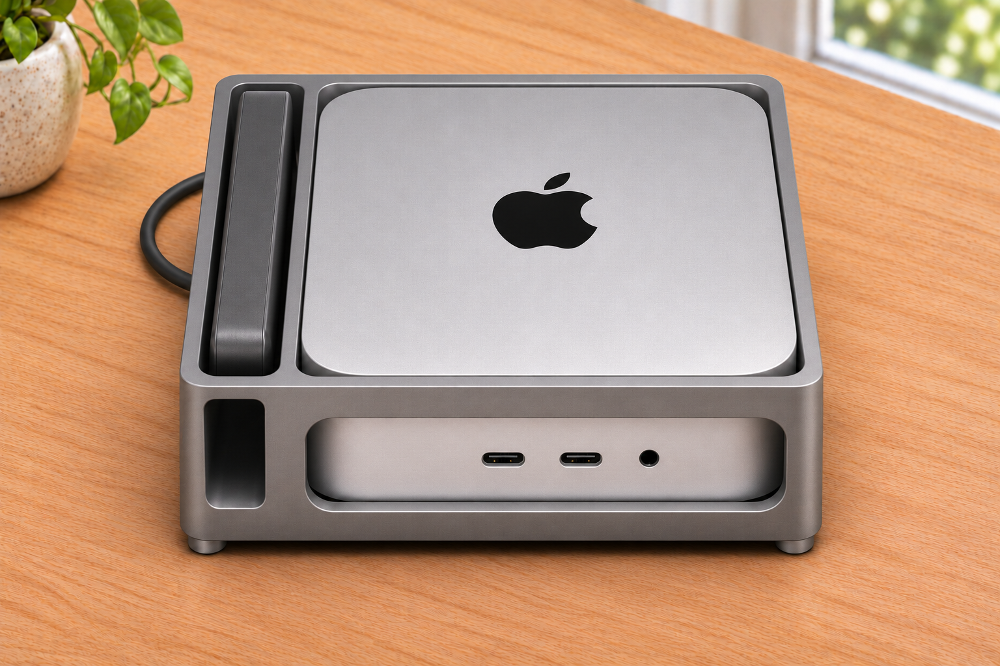
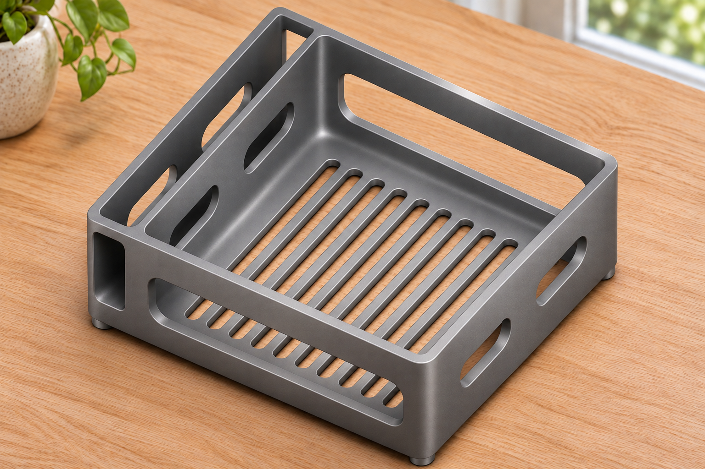
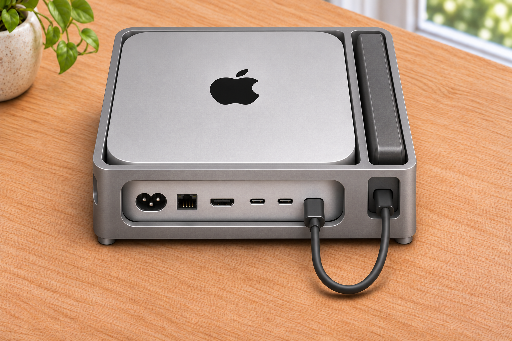

# MiniBerth · 迷你泊位

Mac mini M6 与移动 SSD 的一体式桌面托架。主机从顶部水平放入，硬盘竖插在左侧，短 USB-C 线绕到背面连接两台设备。

**[下载打印模型 STL](models/miniberth.stl) · [下载 A3 完整尺寸图 PDF](docs/dimensions.pdf) · [打印与装配说明](docs/printing.md)**

## 设计尺寸

| 部位 | 名义尺寸 |
| --- | --- |
| 含脚垫的外形 | 156 × 137 × 59 mm |
| 主机腔 | 129 × 129 mm，深 50 mm |
| SSD 槽 | 宽 15 mm，长 129 mm，深 50 mm |
| 四壁、隔墙、底板 | 厚 4 mm |
| 底部 | 11 条通风槽，四角一体脚垫架高 5 mm |

按 [Apple 公布的 Mac mini M6 尺寸](https://support.apple.com/en-us/128108) 设计，裸机居中时每侧名义余量为 1 mm。当前版本尚未实物试打或试装。

## 外观与走线

| 空架 | 后方 USB-C 走线 |
| --- | --- |
|  |  |

桌面场景为生成的外观示意图。实际几何请参照 [STL 底部预览](docs/gallery/M6-symmetric-preview.png)、[六视图](docs/views.png) 和尺寸图。STL 只定义形状，星空灰为展示配色。

## 许可

原创托架设计、模型、图纸与文档采用 [CC BY 4.0](LICENSE.md)。可复制、修改和商用，请注明来源并说明修改。Apple、Mac mini 及相关标志属于其权利人。本项目为独立配件设计。

## 修改设计

用 OpenSCAD 打开[可编辑模型](models/miniberth.scad)，可调整腔体、接口窗、格栅和脚垫。这份源文件按名义尺寸重建，未验证与已发布 STL 的逐面一致性；打印基准为上面的 STL。
